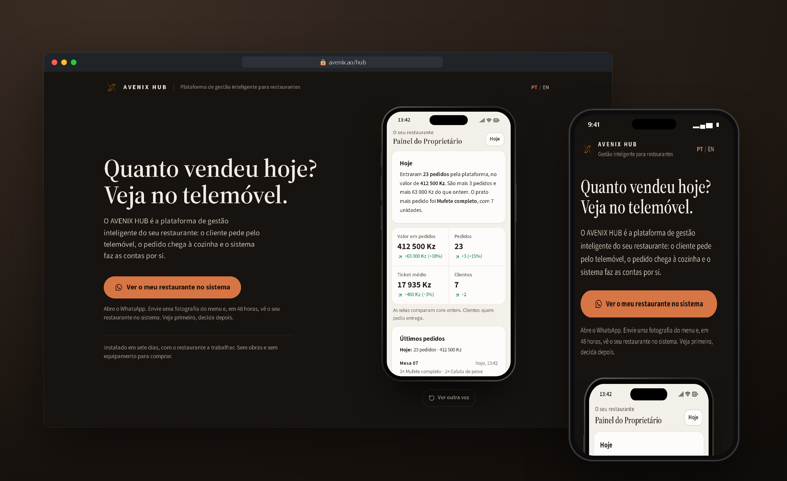
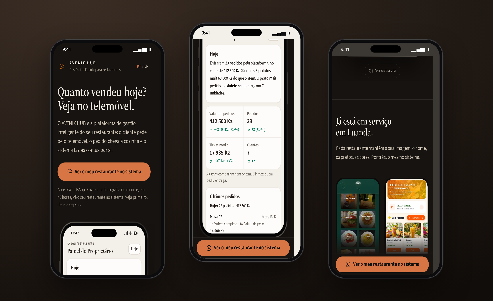
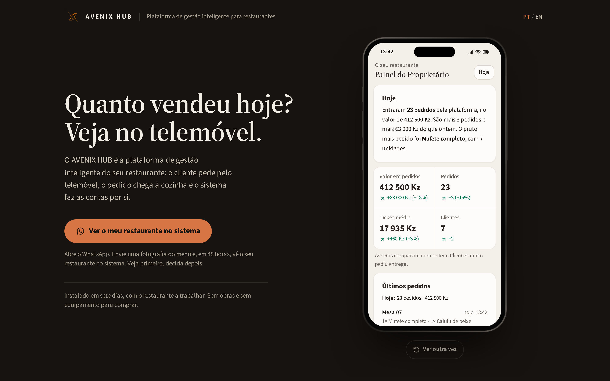

# AVENIX HUB · Product Landing Page

Bilingual product landing page for a restaurant management platform, built for a client.

 

## Highlights

- **Animated product demo:** a phone that plays the owner dashboard live, with new orders, daily sales and average ticket.
- **Bilingual:** Portuguese and English with a one-tap switch.
- **Conversion focused:** one WhatsApp call to action for lead capture.
- **Mobile first:** designed for phones, scales to desktop.

## Mobile

## Desktop

## Stack

  

## My role

Full-stack development: requirements, UI, front-end, back-end, deploy and support in production.

## Source code

The source code is private because it belongs to the client. I am happy to walk through the architecture and the code in an interview.

---

Built by **[Erick Rodrigues](https://github.com/Erickrodrigues05)**, Full-Stack Developer · [erickrodrigues781@gmail.com](mailto:erickrodrigues781@gmail.com)

